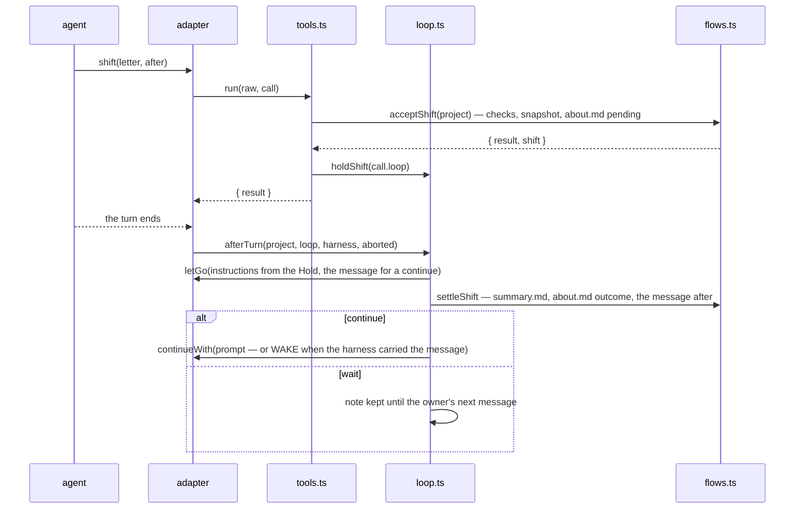

# shift: architecture

<!-- toc -->
- Core and adapters
- The core's modules
- How a shift runs
- Where a change goes
- Tests
<!-- /toc -->

The core holds everything that does not depend on a harness; an adapter is wiring plus a few small ports. A behaviour written in an adapter is written once per harness and drifts — the second review found four such drifts in the shift loop alone — so anything two adapters would do the same way belongs in the core.

## Core and adapters

Each adapter locates its bundled runtime and asks it to prepare the project-local task command at session start. The runtime returns the path that the agent can use for ordinary Beads commands. The core uses `saved.ts` for shift history. Archive operations go to bbolt through the runtime's stdin interface. Saving and restoring a letter require only the archive and project records. See the [storage roadmap](beads-roadmap.md) for acceptance scenarios.

`core/src/` is pure TypeScript with no harness imports. A harness may load only files inside its plugin folder, so `scripts/sync-core.ts` copies `core/src/` into `adapters/claude-code/hooks/core/` and `adapters/npm/core/`, which pi's and opencode's entries share; the copies are never edited, and the pre-commit hook fails on a stale one. The Codex launcher runs from the checkout and imports the core directly.

An adapter keeps only what its harness alone can do:
- where its state lives (Claude Code: plugin atoms; pi: variables, a session entry for the waiting letter);
- measuring the history (tokens, window, the harness's own let-go threshold);
- letting the history go and starting a turn;
- delivering text: the doctrine, a hint, the message after a shift, the owner's rows;
- registering the core's tools and the commands: `/unshift`; `/shift` — the owner's word to shift now, a turn of its own after the one in flight with the words typed after it (`SHIFT_NOW`); and `/shift-tasks` — the project task command (`tasksView`).

## The core's modules

Each is one place for its concern; the interface is what a caller must know.

| Module | Holds | Interface |
|---|---|---|
| `project.ts` | one project as an operation sees it | `loadProject(store, root) → Project`: the store, the root, the parsed settings, what is wrong with `settings.toml`, the keys it sets. A broken file leaves the mod on with the defaults and refuses a shift. The session-start lifecycle initializes the versioned file. Every other load is read-only. Every flow takes a `Project`, loaded once per hook or tool call |
| `sizes.ts` | on-demand size table | measures the session and continuation renderers, counts the documentation and knowledge map inside its file, and reports historical letters separately |
| `working.ts`, `editing.ts` | current internal records | The project store resolves logical paths against one archive view per operation. Revision checks guard edits and snapshot acceptance. File-backed sources retain their regular store operations. The native runtime owns private draft paths and the working-record transaction. See [Records](records.md). |
| `store.ts` | the storage port and the records over it | `Store`: read, list, `stamps` (a folder's files with their time and size, one listing), write, exists, `git(root, args)`; a write is whole or none — one that fails leaves the file as it was —, and a link counts as what it points to. `readRecords(project)` puts OWNER.md, GLOSSARY.md and SHIFT.md where the settings say |
| `layout.ts` | names and limits | `NAMES` — every record's file name once; the paths built from it; `atPlaces(text, files)` renders the configured owner and glossary locations while keeping the map at its internal path |
| `tools.ts` | the tool table | `TOOLS` — a row per tool: its texts (`texts/tools.ts`), whether it writes or belongs to the docs, and `run(raw, call) → { result } \| { deny }`; the `call` carries the harness's `Loop` and `cannotLetGo` (why the harness would not let this history go now, so a shift is refused before anything is written), so the `shift` row refuses a second shift a turn and holds the accepted one itself — an adapter only registers rows and passes the answer on. `shownTools(settings)`, `sessionDoctrine(settings)` (the doctrine with the tools shown, at the settings' places — also an adapter's fallback before a session start), `startSession(project)` (the rows for the owner, the tools shown, the doctrine) |
| `loop.ts` | the shift loop | over a `Loop` port (state `{ pending, note }`, `update`, `tell`) and a `LetGoHarness` (`fill`, `letGo(instructions, carry?)`, `continueWith`, `afterLetGo`): `holdShift`, `afterTurn`, `holdOwner`, `waitingNote`, `loopHint` (no hint while a shift is pending). A continue shift's message is built before the let-go — `handBack` and `continuePrompt`, never the post-let-go state — and a harness able to put it into the replacement history takes it as `carry` and answers `carried`; the turn then starts from `WAKE`, one line, and the note kept for a turn that did not start carries that line too. An owner's message while a shift is pending or lets the history go finds no letter yet: a harness that can take the message back holds it (`holdOwner`), and it goes after the letter in the same prompt; one that can keep it in its hook until the shift is over (`awaitShift`) gets the shift's message as a note for it — a held message is never dropped, whatever becomes of the shift; one that cannot hears it, and the letter follows the message at once instead of waiting for another. A delivered letter clears only itself; `dropWaiting` drops one a newer letter superseded — a continued shift's, `/unshift`'s; `shiftNow` puts a letter still waiting before the owner's `/shift`. A harness's reason for not letting go reaches the note, the row and about.md in the mod's words (`ourWords`), a path as it is. A shift accepted and then not made, or let go and not handed back, is told to the agent too — it was told the shift was accepted: at once with a continue, else with the owner's next message |
| `hint.ts` | when to hint and the gauge | `shiftHint` is a pure rule over a `Gauge` and a reading; `takeHint`, `countGrowth`, `gaugeStatus` keep the gauge over a `GaugeKeeper` port (read, update, the history's growth, the base, a reading) |
| `delivery.ts` | everything the mod tells the agent | two slots over a `Courier` port (the loop, the gauge, the project, the looks — `{ seen, running, written }` — and their `update`): `beforeTool` → notes kept for the result, looked at only by the first of tools started together; `afterTool(courier, before, end)` → the records changed around the tool, a hint, and its written file remembered; `afterWrite` remembers a subagent's (opencode passes the main session's courier); `atPrompt` → the records changed between turns, the files written settled (not while a tool runs: it may be an edit), a hint, the waiting letter last; nothing of it — the records seen, the tocs (written only then, and only over a file unchanged since), the hint, the letter — is marked told until `delivered`, so a prompt that failed or was dropped leaves it for the next; the tool slot keeps what it saw at once and gives a hint in the same change that finds it, so tools ending together never share one; `runEnded`. No queue: every note is pulled at its slot. The installed Codex hooks use the record and document parts of these slots over persisted looks, and the transcript reader supplies the hint. Each kind (`NOTE_KINDS`) is wrapped in `<shift note=…>` and told to the owner as a row; an adapter only puts the strings where its harness lets it |
| `flows.ts` | the flows over the store | `changedRecords(project, seen, by)` (the records changed since the last look, by the agent or someone else, each checked by its file's checks; a plain body), accepting a shift with its snapshot, history, `/unshift`, what follows a let-go, the base after a restart, the session's files, keeping `.shift/` out of git |
| `about.ts` | `about.md` | `renderAbout`, `OUTCOME` (what a `result:` line may say), `readAbout`, `shiftFill` |
| `markdown.ts` | reading markdown | `headings` and `blocks` — the one reader of headings, outside CommonMark code fences; `linkTargets` (a text's Markdown link targets outside fences, decoded), `sections`, `title`, `pinned` (`> [!IMPORTANT]` blocks with their section), `lineCount`, `overLimit`, `dated`, `frontmatter` |
| `records.ts`, `glossary.ts` | the checks of the records | `checkWork(work, project)` checks the current text. Setup and acceptance also compare a legacy owner record with its most recent snapshot; `checkWritten(path, work, project)` — only the checks of one file; a refusal names the files where the settings put them |
| `paths.ts` | paths | `dirname` (`.` for a path with no folder), `basename`, `join` (where `.` is the folder itself), `normalize` (null when it climbs out), `resolvePath`, `fromRoot`, `isInside` — one place for a path's folder and name |
| `settings.ts` | `settings.toml` | `SETTING_KEYS` — a row per key: the version it came in, the kind of its value, where it lives in `Settings`, what it does. `settingsDocument` prepares a schema migration in memory. `parseSettings` returns the settings and the keys set |
| `map.ts` | per-session documentation observations | stores document and section fingerprints and compares the next observation with the session's checkpoint. The adapters own the checkpoint lifetime. |
| `docs.ts` | the project's documents | `refreshDocs` (tocs and the map in one pass, pinned blocks under their documents; `tocs: false` for the map alone), `followWrite` (mid-run: the map only), `settleDocs` (after the run: the tocs and remarks of the files written), `docsReport`, `docOutline`, `docsMentioning` and `readMapped` (whole document or knowledge file, or one heading and its descendants); `[docs] dirs` takes folders or single `.md` files. The map's and a toc's markers count only on lines of their own outside code fences, so a sentence or an example naming them is never replaced; a document written again before its note went is settled again. `docStamps` observes mapped documents and local knowledge revisions, excluding the generated map itself; the next prompt settles one a script changed like one written |
| `input.ts` | tool arguments | `parseShiftInput`, `parseHistoryCount`, `parsePath` over one set of helpers |
| `texts/` | every word the model or the owner reads | `doctrine.ts` (the system-prompt section, the guide, the setup's tree), `tools.ts`, `prompts.ts` (the message after a shift, the summarizer's instructions), `rows.ts` (the owner's rows) |

## How a shift runs

A harness that parks a wait letter in durable history acknowledges `parkWait` before the core publishes the waiting outcome. Every outcome is written to the shift's `about.md` and told to the owner: an aborted turn and a let-go the harness refused are `not shifted`, a failure after the history was let go is `let go, not settled`, a turn that does not start after a settled shift is a row only and its letter waits for the owner's next message. `afterTurn` claims the pending shift in the same change that clears it, so two ends of one turn never let go twice.

## Where a change goes

- **A new tool:** its name in `layout.ts`, its texts in `texts/tools.ts`, a row in `tools.ts`. The adapters register every row; only a Claude Code test that calls it needs its arguments in `McpToolInputs` (`types/index.d.ts`).
- **A new settings key:** one row of `SETTING_KEYS` with the version it ships in; `shift_setup` shows it as new.
- **A new record file:** its name in `NAMES`; `readRecords` loads it and `savedFiles` selects its snapshot contents. Document the record in the guide and setup report.
- **A rule the model reads and a check enforces:** the text interpolates the constant the check uses, so they cannot drift; a section list is rendered from its constant, and a section without its description does not compile.
- **A new harness:** an adapter that fills `Store`, `GaugeKeeper`, `Loop` and `LetGoHarness`, registers `TOOLS`, and delivers the doctrine, hints and the message after a shift — see `docs/adapters.md` for the slots.

## Tests

- `core/test/` — all core logic under `bun test`, over an in-memory store (`memory.ts`: `memoryStore`, `memoryProject`) and one set of fixtures (`fixtures.ts`); runs in the pre-commit hook.
- `adapters/claude-code/tests/` — the plugin's wiring under `claude plugin test`: hooks, atoms, delivery. It imports nothing to test logic.
- `adapters/npm/test/` — pi's extension over a stand-in of pi's API and a temporary project.
