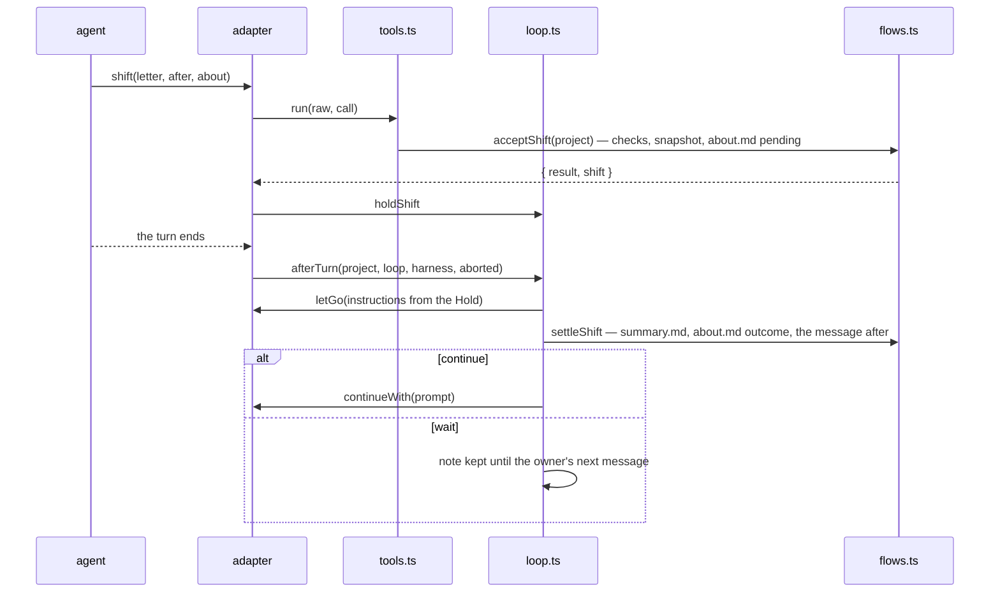

# shift: architecture

<!-- toc -->
- Core and adapters
- The core's modules
- How a shift runs
- Where a change goes
- Tests
<!-- /toc -->

The core holds everything that does not depend on a harness; an adapter is wiring plus a few small ports. A behaviour written in an adapter is written once per harness and drifts — the second review found four such drifts in the shift loop alone — so anything two adapters would do the same way belongs in the core.

## Core and adapters

`core/src/` is pure TypeScript with no harness imports. A harness may load only files inside its plugin folder, so `scripts/sync-core.ts` copies `core/src/` into `adapters/claude-code/hooks/core/` and `adapters/pi/core/`; the copies are never edited, and the pre-commit hook fails on a stale one.

An adapter keeps only what its harness alone can do:
- where its state lives (Claude Code: plugin atoms; pi: variables, a session entry for the waiting letter);
- measuring the history (tokens, window, the harness's own let-go threshold);
- letting the history go and starting a turn;
- delivering text: the doctrine, a hint, the message after a shift, the owner's rows;
- registering the core's tools and the `/unshift` command.

## The core's modules

Each is one place for its concern; the interface is what a caller must know.

| Module | Holds | Interface |
|---|---|---|
| `project.ts` | one project as an operation sees it | `loadProject(store, root) → Project`: the store, the root, the parsed settings, what is wrong with `settings.toml`, the keys it sets. A broken file leaves the mod on with the defaults and refuses a shift. Every flow takes a `Project`, loaded once per hook or tool call |
| `store.ts` | the storage port and the records over it | `Store`: read, list, write, exists, move, `git(root, args)`. `readWork`/`writeSnapshot` read and write the records by the same names; `readRecords(project)` puts OWNER.md, GLOSSARY.md and SHIFT.md where the settings say |
| `layout.ts` | names and limits | `NAMES` — every record's file name once; the paths built from it; `taskFile`; `atPlaces(text, files)` moves the default paths of OWNER.md, GLOSSARY.md and SHIFT.md in a text to the project's places in one pass |
| `tools.ts` | the tool table | `TOOLS` — a row per tool: its texts (`texts/tools.ts`), whether it writes or belongs to the docs, and `run(raw, call) → { result } \| { deny }`. `shownTools(settings)`, `startSession(project)` (the rows for the owner, the tools shown, the doctrine) |
| `loop.ts` | the shift loop | over a `Loop` port (state `{ pending, streak, note }`, `update`, `tell`) and a `LetGoHarness` (`fill`, `letGo`, `continueWith`, `afterLetGo`): `holdShift`, `afterTurn`, `ownerSpoke`, `waitingNote`, `loopHint` |
| `hint.ts` | when to hint and the gauge | `shiftHint` is a pure rule over a `Gauge` and a reading; `takeHint`, `countGrowth`, `gaugeStatus` keep the gauge over a `GaugeKeeper` port (read, update, the history's growth, the base, a reading) |
| `flows.ts` | the flows over the store | `afterWrite` (the docs follow a written file, a record gets the checks of that file), accepting a shift with its snapshot, archiving, history, `/unshift`, what follows a let-go, the base after a restart, the session's files, keeping `.shift/` out of git |
| `about.ts` | `about.md` | `renderAbout`, `OUTCOME` (what a `result:` line may say), `readAbout`, `shiftFill` |
| `markdown.ts` | reading markdown | `headings` and `blocks` — the one reader of headings, outside CommonMark code fences; `sections`, `title`, `pinned` (`> [!IMPORTANT]` blocks with their section), `itemsOf` (`- [status] name — note`), `formatItem`, `lineCount`, `overLimit`, `dated`, `frontmatter` |
| `records.ts`, `tasks.ts`, `glossary.ts`, `archive.ts` | the checks of the records | `checkWork(work, previous, project)` and the checks under it; `checkWritten(path, work, project)` — only the checks of one file; a refusal names the files where the settings put them |
| `settings.ts` | `settings.toml` | `SETTING_KEYS` — a row per key: the version it came in, the kind of its value, where it lives in `Settings`, what it does. `parseSettings` returns the settings and the keys set |
| `docs.ts` | the project's documents | `refreshDocs` (tocs and the map in one pass, pinned blocks under their documents), `docsAfterWrite`, `docsReport`, `docOutline`, `docsMentioning`; `[docs] dirs` takes folders or single `.md` files |
| `input.ts` | tool arguments | `parseShiftInput`, `parseArchiveInput`, `parseTrackInput`, `parseHistoryCount`, `parsePath` over one set of helpers |
| `texts/` | every word the model or the owner reads | `doctrine.ts` (the system-prompt section, the guide, the setup's tree), `tools.ts`, `prompts.ts` (the message after a shift, the summarizer's instructions), `rows.ts` (the owner's rows) |

## How a shift runs

Every outcome is written to the shift's `about.md` and told to the owner: an aborted turn and a let-go the harness refused are `not shifted`, a failure after the history was let go is `let go, not settled`, a turn that does not start after a settled shift is a row only.

## Where a change goes

- **A new tool:** its name in `layout.ts`, its texts in `texts/tools.ts`, a row in `tools.ts`. The adapters register every row; only a Claude Code test that calls it needs its arguments in `McpToolInputs` (`types/index.d.ts`).
- **A new settings key:** one row of `SETTING_KEYS` with the version it ships in; `shift_setup` shows it as new.
- **A new record file:** its name in `NAMES`; `readWork` and `writeSnapshot` read and write it, the guide and the setup's tree describe it.
- **A rule the model reads and a check enforces:** the text interpolates the constant the check uses, so they cannot drift; a section list is rendered from its constant, and a section without its description does not compile.
- **A new harness:** an adapter that fills `Store`, `GaugeKeeper`, `Loop` and `LetGoHarness`, registers `TOOLS`, and delivers the doctrine, hints and the message after a shift — see `docs/adapters.md` for the slots.

## Tests

- `core/test/` — all core logic under `bun test`, over an in-memory store (`memory.ts`: `memoryStore`, `memoryProject`) and one set of fixtures (`fixtures.ts`); runs in the pre-commit hook.
- `adapters/claude-code/tests/` — the plugin's wiring under `claude plugin test`: hooks, atoms, delivery. It imports nothing to test logic.
- `adapters/pi/test/` — the extension over a stand-in of pi's API and a temporary project.
